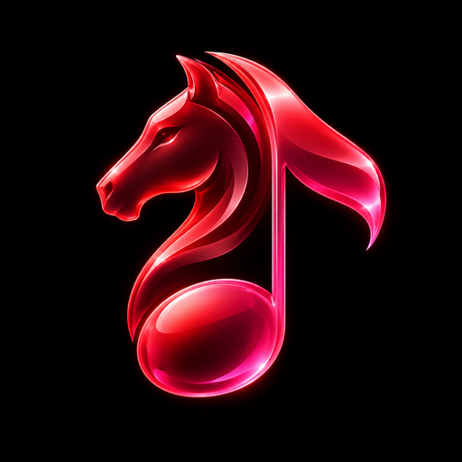
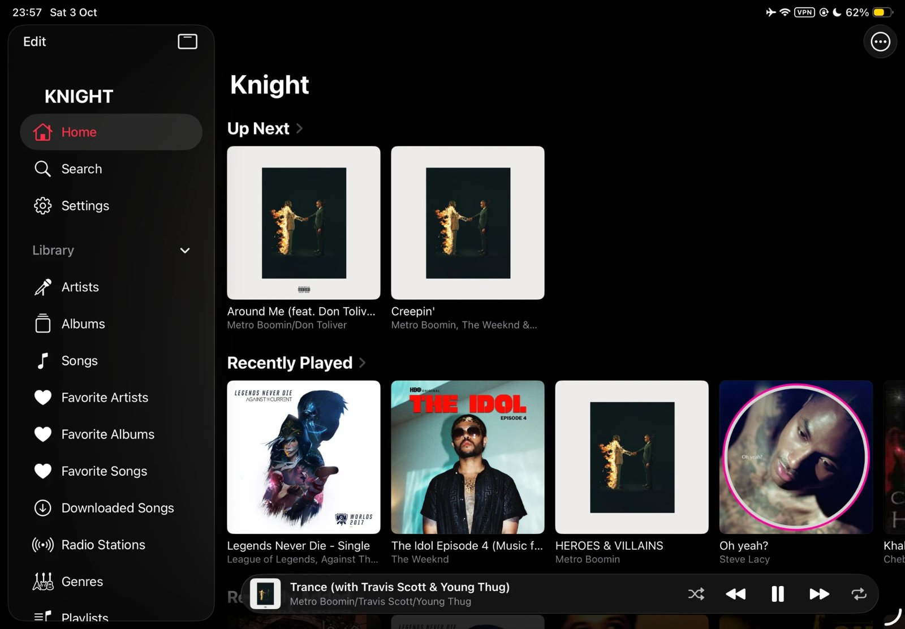
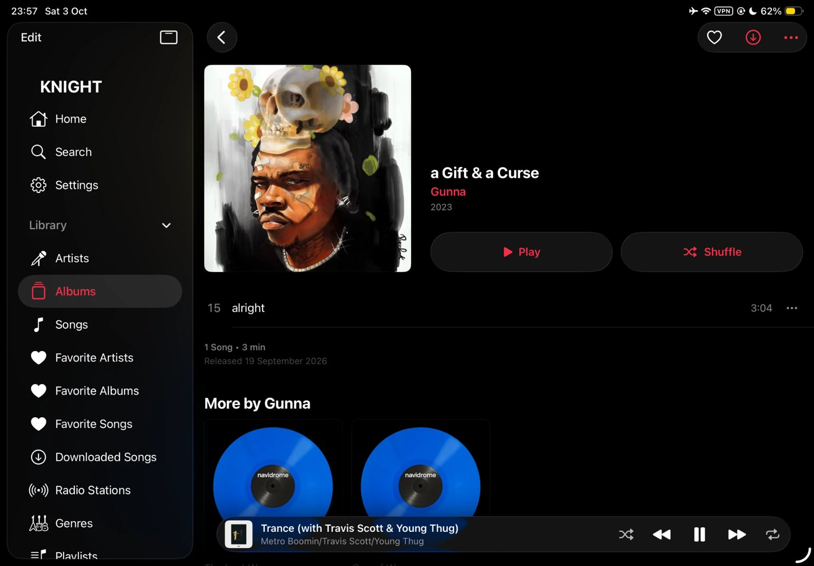
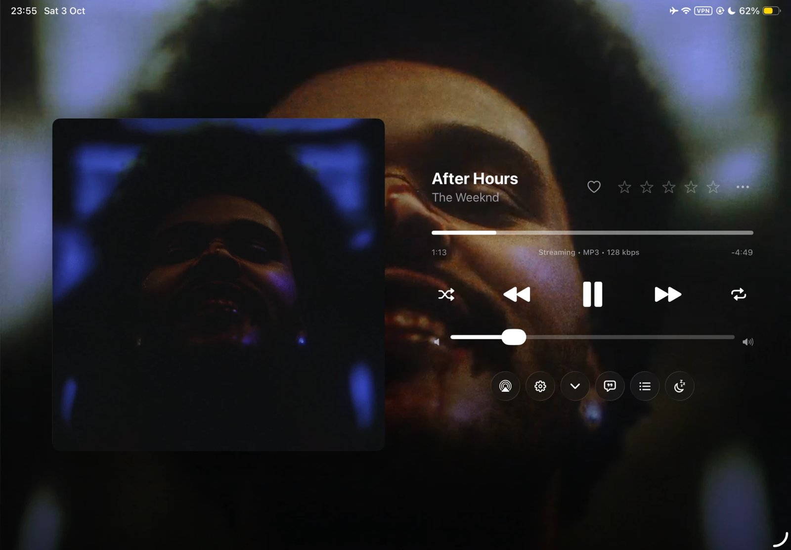
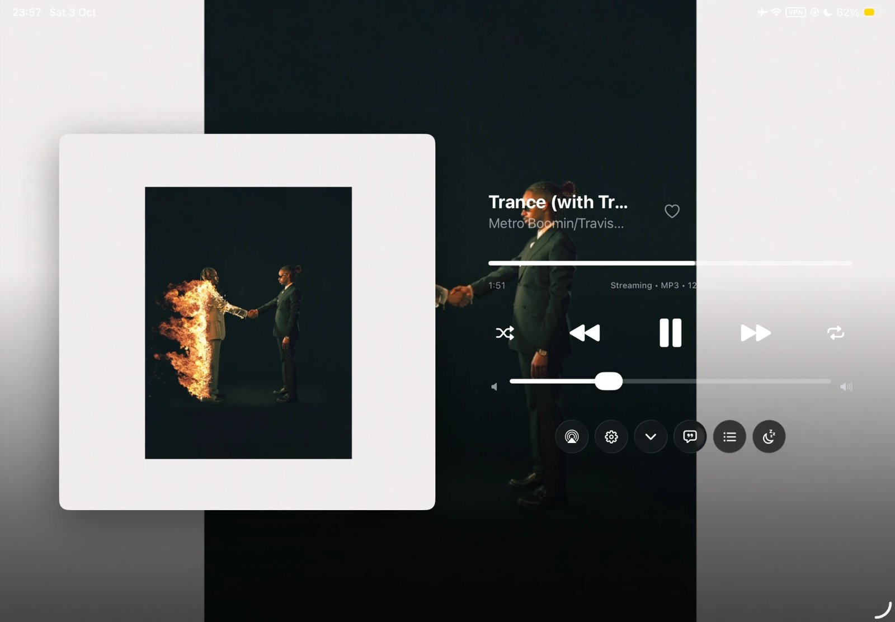
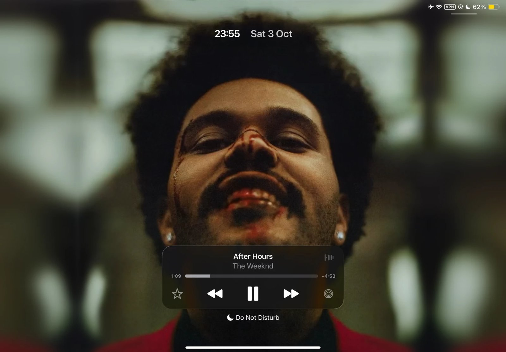
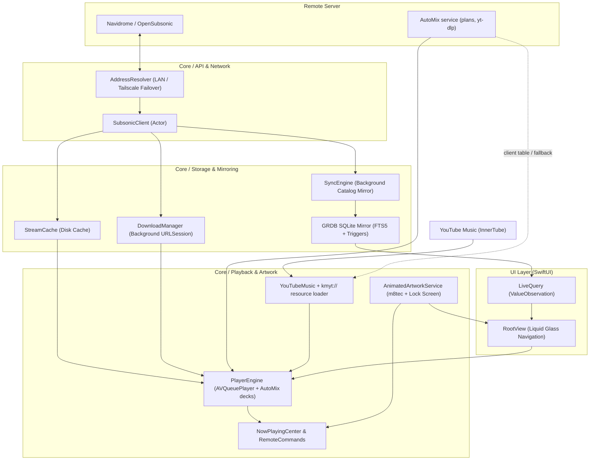

<p align="center">
  
</p>

<h1 align="center">Knight Music</h1>

<p align="center">
  <strong>A native iOS &amp; iPadOS client for Navidrome, built with Apple's Liquid Glass.</strong>
</p>

<p align="center">
  <a href="https://github.com/KNIGHTABDO/knight-music/actions/workflows/ios.yml">
    
  </a>
  <a href="https://developer.apple.com/ios/">
    
  </a>
  <a href="https://swift.org/">
    
  </a>
  <a href="https://developer.apple.com/xcode/swiftui/">
    
  </a>
  <a href="https://www.navidrome.org/">
    
  </a>
  <a href="LICENSE">
    
  </a>
</p>

---

Knight Music is an open-source, native client for [Navidrome](https://www.navidrome.org/) and OpenSubsonic personal music servers, with **YouTube Music** built in next to your own library. It is designed around Apple's Liquid Glass on iOS and iPadOS 26 and pairs an offline-first library, beat-matched **AutoMix** transitions, animated Apple Music artwork, an AI music assistant, CarPlay, widgets and Siri.

**Latest release: [v0.6.0](https://github.com/KNIGHTABDO/knight-music/releases/latest)**: YouTube Music search and playback, Add to Navidrome, self-updating YouTube clients, and AutoMix tempo changes with no audible cut.

## Screenshots

<p align="center">
  
  
</p>
<p align="center">
  
  
</p>
<p align="center">
  
</p>
<p align="center"><sub>iPadOS 26 · real library on Navidrome · animated Apple Music artwork in the player</sub></p>

## Features

### Your library, offline-first
- **Instant everywhere**: every screen reads a local SQLite mirror (GRDB 7), so lists show at once and work with no connection. Sync writes only changed rows and runs in the background (`BGAppRefreshTask`).
- **Full-text search** with SQLite FTS5 (`unicode61 remove_diacritics 2`, good for Arabic and Latin), search scopes (Top / Artists / Albums / Songs / Playlists), removable recent searches and a genre Browse grid.
- **Home**: Top Picks, Continue Listening, Listen Again, On This Day, Rediscover, new artists, genre shelves, Recently Played / Added, Frequently Played and Random.
- **Library**: artists with an A–Z index and favourites filter; albums as a grid or list with pinned letter headers, many sort orders and a favourites filter; songs, genres, internet radio stations and favourites (artists, albums, songs).
- **Playlists**: create, rename, delete, reorder and edit; add many songs at once; save the queue as a playlist; Navidrome smart playlists.
- **Artist pages**: a stretchy parallax hero, a Latest Release card, Top Songs, Albums and Singles & EPs shelves, and Start Station.
- **Stations (Instant Mix)**: an endless radio from any song that refills itself as you listen.
- **Knight Replay**: your top artists, albums, songs and genres, with minutes and plays per month for a year or all time.
- **Downloads**: a background `URLSession` that survives the app being closed; keep favourites and chosen playlists downloaded; a cellular toggle; a storage breakdown with album artwork. Played streams are cached on disk up to a quota you set, and the next songs can be saved ahead.
- **Multi-select**, swipe actions, drag-and-drop of songs and albums onto the queue, playlists or mini player (iPad), Song Info with Lossless / Hi-Res badges.

### YouTube Music (new in v0.6)
- **One search, two sources**: switch Search between **Library** and **YouTube Music** to find songs, videos, albums, artists and playlists. YouTube Music albums, artists (top songs, discography shelves, "More" grids) and playlists open as full pages.
- **Plays on the phone**: songs stream directly from YouTube Music (AAC) and mix freely with Navidrome songs in the same queue, with crossfade, the stream cache, lock screen and CarPlay.
- **Radio**: Start Station on a YouTube Music song plays YouTube Music's own radio for it.
- **Lyrics**: time-synced from [LRCLIB](https://lrclib.net) when available, otherwise YouTube Music's lyrics.
- **Add to Navidrome**: one tap and the AutoMix server downloads the song, tags it with YouTube Music's metadata, files it under `YouTube/<Artist>/<Album>` in your music folder and starts a Navidrome scan, so it becomes a normal library song.
- **Fixes itself when YouTube changes**: the app never hard-codes a YouTube client version. At launch, and again after any playback failure, it merges three live sources:
  1. your AutoMix server's client table, read from [yt-dlp](https://github.com/yt-dlp/yt-dlp)'s `INNERTUBE_CLIENTS` (the server updates yt-dlp daily, and right away when an extraction fails),
  2. [BitChord](https://github.com/kushagrasinghx/BitChord)'s player client list (only newer versions are taken),
  3. [`config/youtube.json`](config/youtube.json) in this repo: a kill switch, a message, the client order and pinned overrides, applied last.

  If YouTube blocks every on-device client, playback falls back to the AutoMix server, which streams the audio through yt-dlp.

### AutoMix
Apple Music-style **beat-matched transitions** between songs, planned on your server and played sample-accurately by the app.
- The [AutoMix service](server/automix) analyses every song in your library (beats and downbeats, 8-bar phrases, energy, loudness, key) as soon as Navidrome indexes it.
- For each pair of songs it plans a **beatmatch** (phrase-aligned, bass swap on the downbeat, both decks meet halfway in tempo), a **crossfade** with filter sweeps when beat-matching won't work, or **gapless** playback for continuous albums.
- Tempo changes happen on a twin deck with a 120 ms crossover, so there is no audible cut when a song speeds up or slows down.
- A transition preview in the queue shows the timeline with a live playhead, and you can play the real transition. Plans for the queue are fetched ahead of time so AutoMix also works offline.
- An **AutoMix Showcase** playlist updates itself so every song blends into the next.
- Plain crossfade is available when AutoMix is off. YouTube Music songs always use crossfade.

### Player
- `AVQueuePlayer`-based playback with gapless look-ahead, ReplayGain (track / album, peak-clamped), a **10-band equalizer** with presets, playback speed, a sleep timer with fade-out or end-of-song stop, and AirPlay.
- Full-screen player with a zoom transition from the mini player, swipeable artwork, marquee titles that open the album or artist, a mesh background from the artwork palette, heart and 5-star rating, fine scrubbing and a volume bar.
- **Lyrics**: time-synced karaoke lyrics with tap-to-seek and auto-scroll, plus a sync adjuster and tap-to-sync for lyrics that are off.
- **Queue**: drag to reorder, swipe to delete, Play Next / Add to Queue, and a server-synced play queue.

### Animated artwork
- Apple Music animated covers from [artwork.m8tec.top](https://artwork.m8tec.top/): square on iPad and full-bleed tall (3:4) on iPhone.
- **Lock screen and Now Playing** animated artwork through iOS 26's `MPMediaItemAnimatedArtwork` (1:1 and 3:4).
- Animated WebP and GIF covers on your server are turned into looping H.264 videos on the device. Big downloads wait for unmetered Wi-Fi.

### Knight, the AI music assistant
- A chat tab powered by your own [Hermes](https://github.com/NousResearch/hermes-agent) agent server. Ask for music in plain language, by voice or text, to queue songs, build playlists or explore your library.
- When Knight imports new music to your server, the app waits until the songs arrive in your library and then lets you play them.
- **Ask Knight** buttons across the app (for example when a search finds nothing), with saved chat history and runs that continue when you switch apps.

### Everywhere on iOS
- **CarPlay**: Listen Now, Library, Playlists and Downloads tabs with Now Playing and Up Next. CarPlay needs Apple's `carplay-audio` entitlement, so it runs in the simulator and on paid, approved accounts, but not in SideStore builds.
- **Widgets**: Now Playing, Recently Played and Favourites widgets, Lock Screen widgets, **Control Center** controls, and a Kick Live widget.
- **Siri and Shortcuts** through App Intents, including hands-free requests in the car.
- **Spotlight** indexes your albums, artists and playlists. `knightmusic://` deep links open an album, artist or playlist.
- **iPad**: sidebar navigation that collapses in portrait and stays pinned in landscape, keyboard shortcuts (Space, ⌘← / ⌘→, ⌘L, ⌘F, ⌘⇧P), hover effects and drag and drop.
- **In-app updates**: Settings → About checks for new releases and installs them through SideStore. Every release also publishes a SideStore source.

### Servers
- Several servers, with one tap to switch between them. Each server can have several addresses (LAN, Tailscale, a public domain). The app checks them all at once, picks the first that answers, and checks again whenever the network changes.
- Scrobbling with an offline buffer, a server status page with OpenSubsonic extension detection, and quick or full library scans.
- Liquid Glass throughout: a `sidebarAdaptable` TabView, the glass mini player as `tabViewBottomAccessory`, and `GlassEffectContainer` controls. Dark mode is the default, with a light mode option and an accent color you can change.

## Requirements

- **iOS 26.0+** or **iPadOS 26.0+** (iPhone &amp; iPad)
- **Navidrome** or any server implementing the OpenSubsonic / Subsonic API
- Optional: the **AutoMix service** on the Navidrome host for AutoMix, Add to Navidrome and the YouTube fallback (see below). YouTube Music search and playback work without it.

## Install (no Mac needed)

Knight Music is distributed as a pre-built, unsigned iOS application (`.ipa`) that can be sideloaded directly on your device without needing a Mac or a paid Apple Developer account.

1. **Download the IPA**: Obtain the latest `KnightMusic.ipa` from [GitHub Releases](https://github.com/KNIGHTABDO/knight-music/releases).
2. **Sideload with SideStore**:
   - Install [SideStore](https://sidestore.io/) on your device using your free Apple ID.
   - Open SideStore, tap `+`, select `KnightMusic.ipa`, and install.
   - SideStore automatically refreshes the 7-day provisioning profile directly on your device over local Wi-Fi / WireGuard loopback—no computer required after initial setup.
3. **Log in**: Launch Knight Music, enter your Navidrome server address (e.g. `https://music.example.com`), username, and password.
4. **Remote Access with Tailscale**: If your Navidrome server runs on your home local network, install [Tailscale](https://tailscale.com/) on both your server and iOS device. In Knight Music's server settings (**Settings → Manage Addresses**), add both your local LAN address (`http://192.168.1.x:4533`) and your Tailscale address (`http://100.x.y.z:4533`). Knight Music will automatically connect over high-speed LAN when at home and seamlessly fail over to Tailscale when you are away.

## AutoMix server (optional)

The AutoMix service is a small Python service that runs next to Navidrome. It provides beat-matched AutoMix plans, the live YouTube client table, the YouTube audio fallback and "Add to Navidrome". To install or update it on the Navidrome host:

```bash
server/automix/deploy/install.sh
```

This creates a virtualenv in `~/automix`, installs the `knight-automix` systemd unit (low CPU and IO priority) and exposes it at `/automix/v1` on your Tailscale Funnel host and on the LAN at port 4534. Mixing is tuned in `planner.py`, and changes ship without an app release. See [server/automix/README.md](server/automix/README.md) for the analysis pipeline and the API.

| YouTube endpoint | Purpose |
|---|---|
| `GET /automix/v1/yt/clients` | yt-dlp's current InnerTube client table (read by the app) |
| `GET /automix/v1/yt/audio/<videoId>` | audio fallback through yt-dlp, with byte ranges |
| `POST /automix/v1/yt/import` + `GET /automix/v1/yt/import/<videoId>` | Add to Navidrome, and its progress |

## Architecture

The application is structured into decoupled core services, local database mirroring, and a pure SwiftUI presentation layer.



### Data Flow

```text
Navidrome API ──► SubsonicClient ──► SyncEngine ──► GRDB SQLite ──► LiveQuery ──► SwiftUI Views
```

- **Offline-First Reactive Queries**: Views observe database records through `LiveQuery`, an `@Observable` wrapper around GRDB's `ValueObservation`. Lists render immediately from local SQLite and update automatically whenever records change.
- **Independent Audio Pipeline**: `PlayerEngine` manages playback using `AVQueuePlayer` and resolves audio sources with prioritized fallback: Local Download → Stream Cache → Live Server Stream. AutoMix adds a second deck with host-time-synced starts and an audio tap for gain and filters.
- **YouTube Music**: songs have `yt:<videoId>` ids and live only in memory, never in the library database. AVPlayer reads them through a `kmyt://` `AVAssetResourceLoaderDelegate`, which resolves a stream with InnerTube player clients, reads it in ranged chunks, and gets a new URL if the old one expires partway through a song. Catalog pages come from YouTube Music's web API (`WEB_REMIX`).
- **Key Dependencies**:
  - **[GRDB.swift 7](https://github.com/groue/GRDB.swift)**: Robust SQLite toolkit managing the local schema, migrations, FTS5 full-text search tables, and reactive database observation.
  - **[Nuke 12](https://github.com/kean/Nuke) / NukeUI**: High-performance image loading, caching, downsampling, and display pipeline for cover artwork and artist portraits.

## Building

The project uses [XcodeGen](https://github.com/yonaskolb/XcodeGen) to define the project structure declaratively in `project.yml`, ensuring clean git diffs without committing `.xcodeproj` bundles.

### Local Generation

If you have macOS and Xcode 26 installed:

```bash
# Install XcodeGen
brew install xcodegen

# Generate the Xcode project file
xcodegen generate

# Open in Xcode
open KnightMusic.xcodeproj
```

### Continuous Integration (CI)

Because primary development can occur on Linux machines without a local macOS environment, GitHub Actions acts as the compiler gate:

- **Push Gate**: Every push to any branch runs `.github/workflows/ios.yml` on a `macos-26` runner to verify compilation against the iOS Simulator SDK.
- **Release Automation**: Pushing any git tag prefixed with `v*` (e.g. `git tag v0.1.0 && git push origin v0.1.0`) triggers an archive build targeting generic iOS hardware. The workflow packages the application into an unsigned `KnightMusic.ipa` and attaches it to a new GitHub Release.
- **Screenshot Pipeline**: Adding `[shots]` to a commit message, running on `main`, or manually dispatching the workflow with `screens: true` executes `scripts/screens.sh`. The script boots iPhone and iPad simulators, sets the status bar clock to 9:41 AM, runs Knight Music in demo mode (`-KMDemo YES -KMScreen <name>`) across every main screen (iPhone, plus iPad in portrait and landscape), captures high-resolution screenshots, and uploads them as the `screens` build artifact.

## Roadmap

- **YouTube Music library sync**: liked songs and your YouTube Music playlists (needs sign-in).
- **CarPlay for sideloaded builds**, if Apple ever allows the `carplay-audio` entitlement on free accounts.
- **Desktop app**: an Electron port is in progress on the `desktop/foundation` branch.

## Acknowledgements

- **[Navidrome](https://www.navidrome.org/)** — Open-source, high-performance music server and streamer.
- **[OpenSubsonic](https://opensubsonic.io/)** — Community-driven open API standards for personal media servers.
- **[GRDB.swift](https://github.com/groue/GRDB.swift)** — Excellent SQLite database library by Gwendal Roué.
- **[Nuke](https://github.com/kean/Nuke)** — Elegant image loading system by Alexander Grebenyuk.
- **[yt-dlp](https://github.com/yt-dlp/yt-dlp)**: its InnerTube client table and extraction power the YouTube Music support and fallback.
- **[BitChord](https://github.com/kushagrasinghx/BitChord)**: a second live source of YouTube player client versions (only read at runtime; no code is copied).
- **[LRCLIB](https://lrclib.net)**: free synced lyrics for YouTube Music songs.
- **[Beat This!](https://github.com/CPJKU/beat_this)**: beat and downbeat tracking behind AutoMix.
- **[artwork.m8tec.top](https://artwork.m8tec.top/)** — High-resolution animated cover artwork API for Apple Music albums.
- **[Arpeggi](https://github.com/arpeggi-app)** — Visual and interaction design inspiration.

## License

This project is open-source software licensed under the [MIT License](LICENSE).

Copyright &copy; 2026 KNIGHTABDO.
