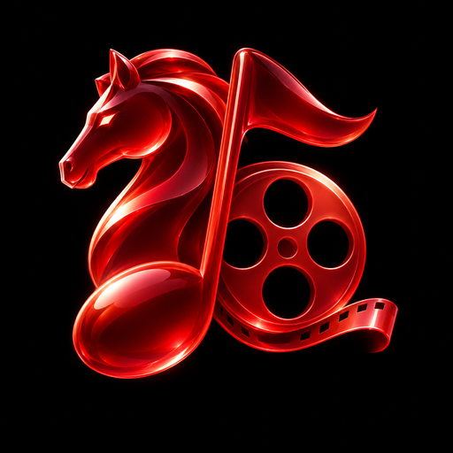
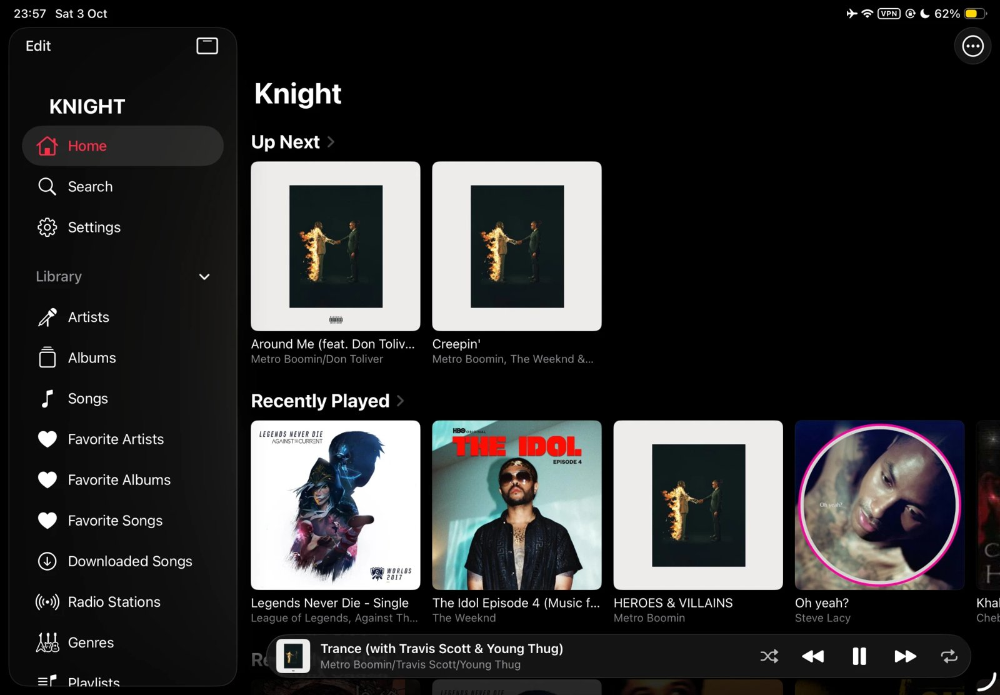
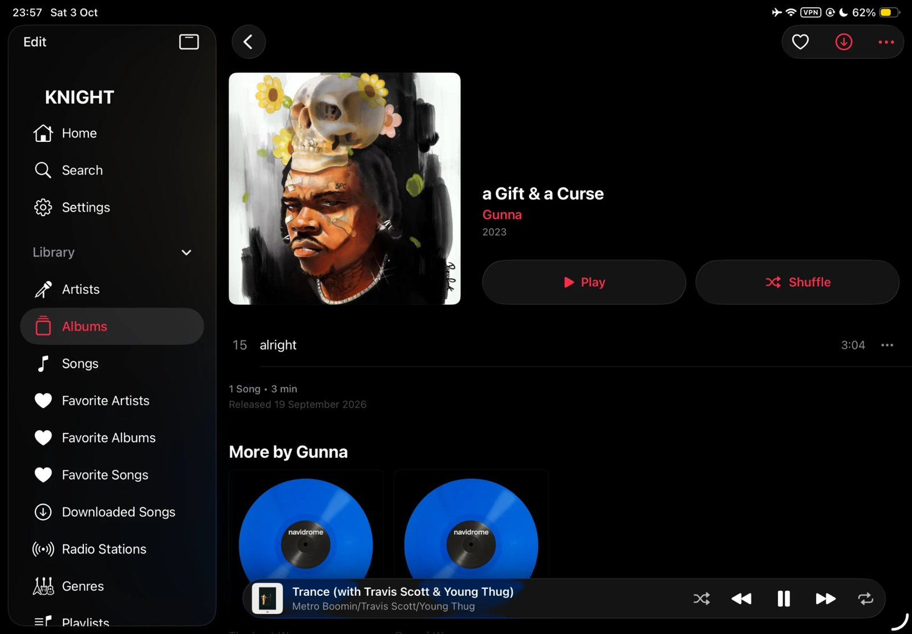
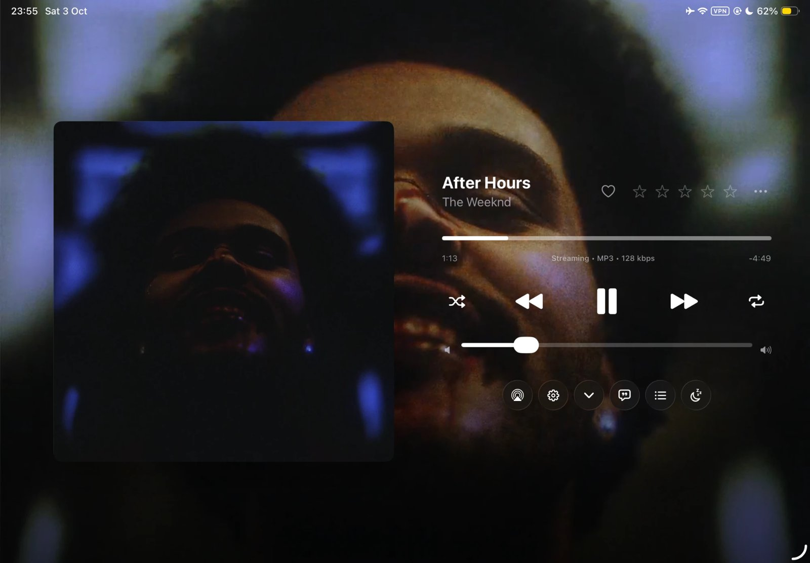
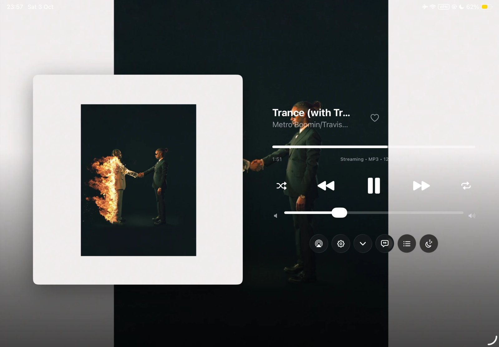
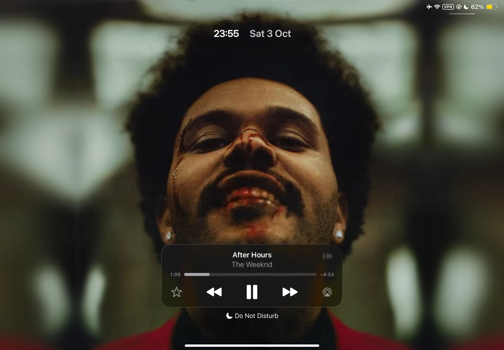
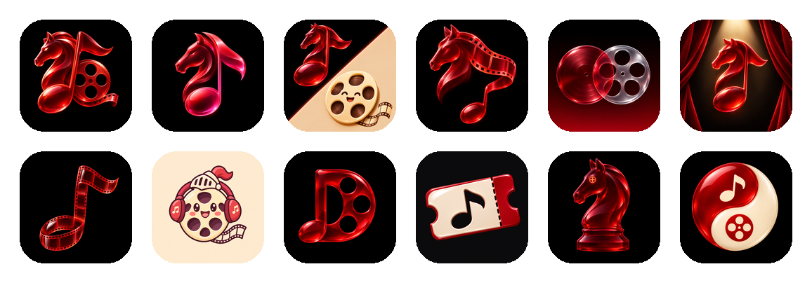
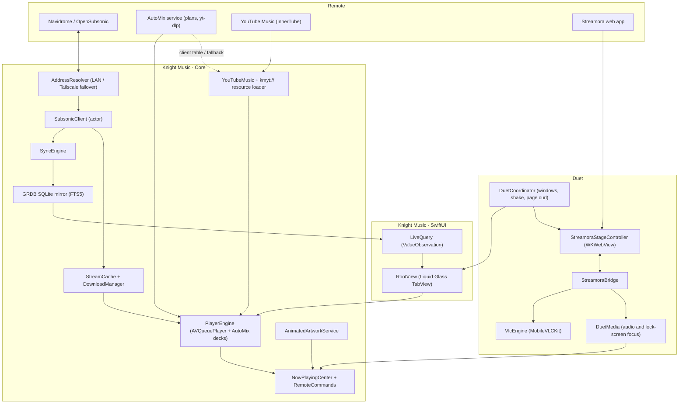

<p align="center">
  
</p>

<h1 align="center">Duet</h1>

<p align="center">
  <strong>Knight Music and Streamora in one native app for iPhone and iPad.</strong><br />
  A Liquid Glass client for your Navidrome library, with movies one shake away.
</p>

<p align="center">
  <a href="https://github.com/KNIGHTABDO/knight-music/actions/workflows/ios.yml"></a>
  <a href="https://github.com/KNIGHTABDO/knight-music/releases/latest"></a>
  
  
  <a href="https://www.navidrome.org/"></a>
  <a href="LICENSE"></a>
</p>

<p align="center">
  <a href="#install">Install</a> ·
  <a href="#features">Features</a> ·
  <a href="#duet-music-and-movies">Duet</a> ·
  <a href="#architecture">Architecture</a> ·
  <a href="#building">Building</a> ·
  <a href="https://github.com/KNIGHTABDO/knight-music/releases">Releases</a>
</p>

---

**Duet** is an open-source iOS and iPadOS 26 app made of two halves:

- **Knight Music**, a native SwiftUI client for [Navidrome](https://www.navidrome.org/) and other OpenSubsonic servers. It has an offline-first library, beat-matched **AutoMix** transitions, **YouTube Music** next to your own songs, animated Apple Music artwork on the lock screen, song recognition, an AI music assistant, widgets and Siri.
- **Streamora**, a personal movie and TV app, with its native VLC player and Google Drive sync.

Shake the phone to switch between them. Each side keeps its exact state while you use the other, and both share one lock screen. Because it is one app, it uses one App ID and one SideStore slot.

Duet is built entirely with Apple's own Liquid Glass APIs, without custom blur stacks. It ships as an unsigned IPA, so you can sideload it with a free Apple ID; no Mac is needed.

> **Latest release: [v0.9.1](https://github.com/KNIGHTABDO/knight-music/releases/latest)**: tapping the Duet switch prompt no longer reaches the app behind it. v0.9.0 made the app **Duet**: Streamora lives inside Knight Music; shake to switch between music and movies, with one app and one SideStore slot.

## Screenshots

<p align="center">
  
  
</p>
<p align="center">
  
  
</p>
<p align="center">
  
</p>
<p align="center"><sub>iPadOS 26 · a real library on Navidrome · animated Apple Music artwork in the player and on the lock screen</sub></p>

## Contents

- [Install](#install)
- [Features](#features)
  - [Duet: music and movies](#duet-music-and-movies)
  - [Your library, offline-first](#your-library-offline-first)
  - [YouTube Music](#youtube-music)
  - [AutoMix](#automix)
  - [Player](#player)
  - [Animated artwork](#animated-artwork)
  - [Song recognition](#song-recognition)
  - [Knight, the AI music assistant](#knight-the-ai-music-assistant)
  - [Make it yours](#make-it-yours)
  - [Everywhere on iOS](#everywhere-on-ios)
  - [Servers, sync and backup](#servers-sync-and-backup)
- [Requirements](#requirements)
- [AutoMix server (optional)](#automix-server-optional)
- [Architecture](#architecture)
- [Building](#building)
- [Releasing](#releasing)
- [Privacy](#privacy)
- [Roadmap](#roadmap)
- [Acknowledgements](#acknowledgements)
- [License](#license)

## Install

Duet is distributed as a pre-built, unsigned `.ipa`. You install it with [SideStore](https://sidestore.io/) and a free Apple ID; you need neither a Mac nor a paid developer account.

1. **Install SideStore** on your iPhone or iPad with your free Apple ID ([guide](https://docs.sidestore.io/)).
2. **Add Duet**, choosing either way:
   - **Source (recommended):** in SideStore, go to **Sources → +** and add
     `https://github.com/KNIGHTABDO/knight-music/releases/latest/download/apps.json`.
     Updates then appear in SideStore by themselves.
   - **Manual:** download `KnightMusic.ipa` from [Releases](https://github.com/KNIGHTABDO/knight-music/releases/latest), then in SideStore tap **+** and choose the file.
3. **Sign in** to your Navidrome server with its address (for example `https://music.example.com`), your username and your password.
4. **Optional:** open Streamora once (shake, then tap **Switch**) and sign in to Google Drive there. Your profiles, progress and settings come back from Drive. After that you can delete the standalone Streamora app.

> [!TIP]
> **Updates inside the app.** Settings → About checks GitHub for new releases and hands the new IPA to SideStore. SideStore re-signs the app every 7 days on the device; no computer is needed after setup.

> [!NOTE]
> **Remote access.** If Navidrome runs at home, install [Tailscale](https://tailscale.com/) on the server and the phone. Then, under **Settings → Servers → Manage Addresses**, add your LAN address (`http://192.168.1.x:4533`) and your Tailscale address (`http://100.x.y.z:4533`). The app uses the LAN at home and switches to Tailscale on its own when you leave.

## Features

### Duet: music and movies

- **Shake to switch.** A Liquid Glass prompt asks "Switch to Streamora?". Shake again or tap **Switch** to confirm. A countdown ring dismisses the prompt if you change your mind. The switch itself is a page curl between the two sides.
- **Nothing reloads.** Streamora runs in its own window above Knight Music and is only shown or hidden. A half-watched episode and a half-scrolled album both stay exactly where they were.
- **One lock screen.** Starting a movie pauses the music, and the lock screen and remote controls follow whichever side has focus.
- **Intermission.** The music picks up where it stopped when the movie ends or when you switch back.
- **Streamora's full feature set**, including the **native VLC player** (MKV, HEVC, multiple audio and subtitle tracks, AirPlay), Google Drive sync, profiles, Trakt and the hand-drawn interface. It reaches the web app through the same plugin interface as the standalone Streamora app.
- **Shortcuts and quick actions:** "Open Streamora", "Open Knight Music" and "Switch Duet Side" in Shortcuts and Siri, plus a Streamora action on the Home Screen icon.
- **Settings → Duet · Streamora** controls the following:
  - shake to switch
  - Ask Before Switching
  - reopening the last side at launch
  - Intermission
  - reloading Streamora
  - signing Streamora out on this device

### Your library, offline-first

- **Instant everywhere.** Every screen reads a local SQLite mirror ([GRDB 7](https://github.com/groue/GRDB.swift)), so lists appear at once and work without a connection. Sync writes only the rows that changed and also runs in the background (`BGAppRefreshTask`).
- **Full-text search** uses SQLite FTS5 with diacritic folding, which works well for Arabic and Latin scripts. It has scopes (Top, Artists, Albums, Songs, Playlists), recent searches and a genre Browse grid.
- **Home** has these shelves:
  - Top Picks
  - Continue Listening
  - Listen Again
  - On This Day
  - Rediscover
  - New Artists
  - genre shelves
  - Recently Played and Recently Added
  - Frequently Played and Random
- **Library** has a Library Hub you can reorder, plus:
  - artists with an A–Z index
  - albums as a grid or a list, with pinned letter headers and many sort orders
  - songs, genres and internet radio
  - favorites
- **Playlists:** create, rename, reorder and edit them, and add many songs at once. You can also save the queue as a playlist and use Navidrome smart playlists. Shared playlists offer **Create Copy & Add**.
- **Artist pages** have a parallax hero, a Latest Release card, Top Songs, Albums, Singles & EPs, and Start Station.
- **Stations (Instant Mix):** endless radio from any song, refilled as you listen.
- **Knight Replay** shows your top artists, albums, songs and genres, with minutes and plays per month, for any year or for all time.
- **Library care:**
  - **Edit song info** (title, artist, album, year, genre, track, disc).
  - **Duplicate Songs** keeps the best copy and moves the rest to the server's trash.
  - Song Info shows **Lossless** and **Hi-Res** badges.
- **Downloads:**
  - A background `URLSession` keeps downloading after the app closes.
  - Favorites and chosen playlists can stay downloaded.
  - **Download Most Played This Week** in one tap.
  - A cellular toggle and a storage breakdown.
  - Played streams are cached on disk up to a quota you choose, and upcoming songs are saved ahead.
- **Multi-select, swipe actions and drag and drop:** drop songs and albums onto the queue, a playlist or the mini player on iPad. Queue removals can be undone.

### YouTube Music

- **One search, two sources.** Switch Search between **Library** and **YouTube Music** to find songs, videos, albums, artists and playlists, each with a full page. **Discover** adds a browse feed and Moods & Genres.
- **Plays on the phone.** Songs stream straight from YouTube Music (AAC). They join the same queue as your Navidrome songs and get crossfade, the stream cache, the lock screen and CarPlay. YouTube songs show **In Library** badges when you already own them.
- **Radio and lyrics.** Start Station plays YouTube Music's own radio for a song. Lyrics are time-synced from [LRCLIB](https://lrclib.net) when available; otherwise the app shows YouTube Music's lyrics.
- **Add to Navidrome.** One tap (or **Add All** for an album or playlist) downloads the song on your server. The server tags it with YouTube Music's metadata, files it under `YouTube/<Artist>/<Album>` and starts a scan. Queued YouTube songs switch to the library copy as soon as it arrives.
- **Fixes itself when YouTube changes.** The app never hard-codes a YouTube client version. At launch, and again after any playback failure, it merges three live sources:
  1. your AutoMix server's client table, taken from [yt-dlp](https://github.com/yt-dlp/yt-dlp)'s `INNERTUBE_CLIENTS` (the server updates yt-dlp daily, and right away after a failed extraction);
  2. [BitChord](https://github.com/kushagrasinghx/BitChord)'s player client list (only newer versions are used);
  3. [`config/youtube.json`](config/youtube.json) in this repo, which holds a kill switch, a message, the client order and pinned overrides, and is applied last.

  If YouTube blocks every on-device client, playback falls back to the AutoMix server, which streams the audio through yt-dlp.

### AutoMix

Apple Music-style **beat-matched transitions**, planned on your server and played sample-accurately by the app.

- The [AutoMix service](server/automix) analyzes every song as soon as Navidrome indexes it. It finds beats and downbeats, 8-bar phrases, energy, loudness and key.
- For each pair of songs it plans one of three transitions:
  - a **beatmatch**: phrase-aligned, with a bass swap on the downbeat, and both tempos meet halfway with pitch kept;
  - a filtered **crossfade**, when beat-matching won't work;
  - **gapless** playback, for continuous albums.
- Tempo changes run on a twin deck with a 120 ms crossover, so a song never cuts out when it speeds up or slows down.
- **Transition preview** in the queue: a timeline of both songs with a live playhead, and a button to hear the real transition. Plans are stored ahead, so AutoMix also works offline with downloaded songs.
- An **AutoMix Showcase** playlist on your server keeps itself up to date so that every song blends into the next.

### Player

- **Engine:**
  - gapless `AVQueuePlayer` playback
  - ReplayGain (track or album, peak-clamped)
  - a **10-band equalizer** with presets
  - playback speed and crossfade
  - a sleep timer that fades out or stops at the end of the song
  - AirPlay
- **Full-screen player:**
  - a zoom transition from the glass mini player
  - a mesh background taken from the artwork's palette
  - marquee titles that open the album or artist
  - a heart and a 5-star rating
  - fine scrubbing and a volume bar
- **Gestures:**
  - double-tap the artwork to love a song
  - swipe it for next or previous
  - hold play for a sleep timer
  - hold next or previous to skip 30 s
  - hold the title to copy it
- **Lyrics:** time-synced karaoke with tap-to-seek, a sync adjuster and tap-to-sync. Hold a line to copy it or share a lyric card.
- **Queue:** drag to reorder, swipe to delete, Play Next and Add to Queue. The play queue is synced with the server, and long tracks resume where you stopped.

### Animated artwork

- Apple Music animated covers from [artwork.m8tec.top](https://artwork.m8tec.top/): square on iPad, and full-bleed tall (3:4) on iPhone.
- **Lock screen and Now Playing** animation uses iOS 26's `MPMediaItemAnimatedArtwork` (1:1 and 3:4).
- Animated WebP and GIF covers on your server are converted on the device into looping H.264 videos. Large downloads wait for unmetered Wi-Fi.

### Song recognition

- Identify what's playing around you, from the app, from **Control Center** or from Siri. The app doesn't need to come to the front. The phone records a short clip, and your AutoMix server identifies it through Shazam.
- The **Dynamic Island** and a Live Activity show the listening state and the match.
- A match opens a drop-down banner with the song from **your library** if you have it, or plays it from YouTube Music in one tap. History offers Play, Play Next, Add to Queue, Add to Library and Share.

### Knight, the AI music assistant

- A chat tab powered by your own [Hermes](https://github.com/NousResearch/hermes-agent) agent server. Ask for music in plain language, by voice or text, to queue songs, build playlists or explore your library.
- When Knight imports music to your server, the app waits until the songs reach your library and then offers to play them. A live progress pill shows what Knight is doing.
- **Ask Knight** buttons appear across the app. Chat history is saved, and runs continue while you are in other apps.

### Make it yours

- **Looks:** a gallery of looks with live preview, an accent color, vinyl or circle artwork, a beat pulse, lyrics and Home layout options, and automatic day and night looks.
- **App icons:** 25 icons in **Customize → Icons**, including twelve Duet icons and the original Knight Red.
- **Shake action:** switch Duet, skip the song, shuffle the library or try a surprise look.

<p align="center">
  
</p>

### Everywhere on iOS

- **CarPlay:** Listen Now, Library, Playlists and Downloads, with Now Playing and Up Next. CarPlay needs Apple's `carplay-audio` entitlement, so it works in the simulator and on approved paid accounts, but not in SideStore builds.
- **Widgets:**
  - Now Playing, Recently Played and Favorites
  - Lock Screen widgets
  - a Kick Live widget
  - **Control Center** controls: Play/Pause, Love, Shuffle Library and Recognize Music
- **Siri and Shortcuts** through App Intents, including hands-free requests in the car. **Home Screen quick actions:** Resume, Streamora, Shuffle Favorites, Recognize Song and Downloads.
- **Spotlight** indexes albums, artists and playlists. `knightmusic://` deep links open them directly, and a copied YouTube link offers to open in the app.
- **iPad:**
  - a sidebar that collapses in portrait and stays pinned in landscape
  - keyboard shortcuts (Space, ⌘← / ⌘→, ⌘L, ⌘F, ⌘⇧P)
  - hover effects and drag and drop
- **Discord Rich Presence** shows what you're listening to, with album artwork.

### Servers, sync and backup

- **Several servers**, with one tap to switch between them. Each server can have several addresses (LAN, Tailscale, a public domain). The app checks them in parallel, uses the first that answers, and checks again whenever the network changes.
- **Backup:** settings, looks, the equalizer, Knight and Discord setup, chats, server addresses and the list of downloaded songs are saved privately to your Navidrome account. They are restored when you sign in on a new device.
- Scrobbling with an offline buffer, a server status page that detects OpenSubsonic extensions, and quick or full library scans.

## Requirements

| | |
|---|---|
| Device | iPhone or iPad on **iOS / iPadOS 26.0** or later |
| Music server | **Navidrome**, or any server implementing the OpenSubsonic / Subsonic API |
| Optional | The **AutoMix service** on the Navidrome host. It provides AutoMix, song recognition, Add to Navidrome, song-info editing, duplicate cleanup and the YouTube fallback. Library browsing, streaming and YouTube Music search and playback work without it. |
| Optional | A [Hermes](https://github.com/NousResearch/hermes-agent) server for the Knight assistant |
| Optional | A Google account (Drive) and a TorBox account for Streamora |

## AutoMix server (optional)

The AutoMix service is a small Python service that runs next to Navidrome. It provides:

- beat-matched AutoMix plans
- song recognition
- the live YouTube client table
- the YouTube audio fallback
- Add to Navidrome
- the library edits that the Subsonic API can't do

To install or update it on the Navidrome host:

```bash
server/automix/deploy/install.sh
```

The script creates a virtualenv in `~/automix` and installs the `knight-automix` systemd unit, which runs at low CPU and IO priority. It serves the API at `/automix/v1` on your Tailscale Funnel host and on the LAN at port 4534.

Mixing is tuned in `planner.py`, and changes ship without an app release. See [server/automix/README.md](server/automix/README.md) for the analysis pipeline and the full API.

| Endpoint | Purpose |
|---|---|
| `GET /automix/v1/plan` · `/showcase` · `/matches` | transition plans, the AutoMix Showcase, songs that beat-match the current one |
| `POST /automix/v1/recognize` | identifies a short recorded clip (song recognition) |
| `POST /automix/v1/songs/<id>/tags` · `/trash` | Edit Song Info and Duplicate Songs |
| `POST /automix/v1/playlists/<id>/edit` | direct edits to playlists you own |
| `GET /automix/v1/yt/clients` | yt-dlp's current InnerTube client table (read by the app) |
| `GET /automix/v1/yt/audio/<videoId>` | audio fallback through yt-dlp, with byte ranges |
| `POST /automix/v1/yt/import` · `GET /automix/v1/yt/import/<videoId>` | Add to Navidrome, and its progress |

## Architecture

Duet is a single SwiftUI app target with a widget extension. Knight Music is split into decoupled core services, a local database mirror, and a SwiftUI presentation layer. Streamora is hosted in its own window and talks to native code over a small bridge.



### Design principles

- **Offline-first.** Views observe the database through `LiveQuery`, an `@Observable` wrapper around GRDB's `ValueObservation`. Screens render from local SQLite immediately. The network only feeds the mirror (`SyncEngine`) or carries out actions such as starring, rating and editing playlists, which are applied to the database optimistically.
- **One audio pipeline.** `PlayerEngine` picks each song's source in priority order: local download, then stream cache, then live server stream. AutoMix adds a second deck with host-time-synced starts and an `MTAudioProcessingTap` for gain and filters.
- **YouTube Music in memory only.** These songs have `yt:<videoId>` ids and never enter the library database. AVPlayer reads them through a `kmyt://` `AVAssetResourceLoaderDelegate`, which does three things:
  - resolves a stream with InnerTube player clients;
  - reads it in ranged chunks;
  - gets a fresh URL if the old one expires partway through a song.
- **Duet windows.** Three windows make up Duet:

  | Window | Level | Role |
  |---|---|---|
  | Knight Music | `.normal` | the main app |
  | Streamora | `.normal + 1` | shown or hidden, never torn down |
  | `DuetHUDWindow` | `.normal + 2` | the glass prompt and the page curl; touches outside the prompt pass through |

  `DuetMedia` decides which side owns the audio session, `MPNowPlayingInfoCenter` and the remote commands.
- **Streamora bridge.** A user script installs a `window.Capacitor` shim, so the unmodified Streamora web app calls `Plugins.StreamoraPlayer` exactly as it does in the standalone app. A `WKScriptMessageHandlerWithReply` (`StreamoraBridge`) answers those calls and drives a native `StreamoraPlayerViewController` built on MobileVLCKit.
- **Real Liquid Glass.** The app uses:
  - a `TabView` with `.sidebarAdaptable`
  - `.tabViewBottomAccessory` for the mini player
  - `glassEffect`, `GlassEffectContainer` and `.buttonStyle(.glass)`

  Glass stays on the navigation and control layer, never on content.

### Project layout

```text
KnightMusic/
  App/            KnightMusicApp, AppModel (root @Observable), AppActionRouter, DebugLaunch (screenshot mode)
  Core/API        Models, SubsonicClient (actor), accounts, Keychain, AddressResolver
  Core/Library    LibraryDatabase (GRDB + migrations + FTS5), SyncEngine, LibraryRepository
  Core/Playback   PlayerEngine (+AutoMix decks), PlayQueue, NowPlayingCenter, RemoteCommands, Scrobbler, StreamCache, SleepTimer
  Core/AutoMix    AutoMixPlan, AutoMixClient, MixTap
  Core/YouTube    InnerTube client, kmyt:// resource loader, live client table
  Core/…          Artwork, Downloads, Recognition, Hermes, Discord, Backup, Customization, Support
  Duet/           DuetCoordinator, DuetHUD, DuetMedia, DuetSettings
  Streamora/      StreamoraStageController, StreamoraBridge(+Script), VlcEngine, StreamoraPlayerViewController
  Intents/        App Intents, Shortcuts, Siri
  CarPlay/        CarPlay scene
  UI/             DesignSystem, Shell, Home, Search, Library, Detail, Player, YouTube, Recognition, Knight, Settings, Onboarding
KnightMusicWidgets/   Now Playing, Recently Played, Favorites, Lock Screen, Control Center, recognition Live Activity, Kick Live
server/automix/       AutoMix service (Python): analysis, planner, YouTube endpoints, deploy scripts
config/youtube.json   remote YouTube client overrides and kill switch
scripts/              screens.sh (CI screenshots), fetch-vlckit.sh (CI dependency)
```

### Dependencies

| Library | Use |
|---|---|
| [GRDB.swift 7](https://github.com/groue/GRDB.swift) | SQLite schema, migrations, FTS5 search, reactive observation |
| [Nuke 12 / NukeUI](https://github.com/kean/Nuke) | artwork loading, downsampling and caching |
| [MobileVLCKit 3.7](https://code.videolan.org/videolan/VLCKit) | Streamora's native video player. This is a prebuilt dynamic xcframework, fetched in CI and embedded in the app. |

## Building

The Xcode project is generated by [XcodeGen](https://github.com/yonaskolb/XcodeGen) from `project.yml`; `.xcodeproj` files are never committed.

### On a Mac (Xcode 26)

```bash
brew install xcodegen
scripts/fetch-vlckit.sh      # downloads and verifies MobileVLCKit into Vendor/ (gitignored)
xcodegen generate
open KnightMusic.xcodeproj
```

### Continuous integration

Development happens on Linux, so GitHub Actions ([`ios.yml`](.github/workflows/ios.yml), `macos-26` runner) is the compiler:

- **Every push** builds against the iOS simulator SDK. MobileVLCKit is fetched once, checked against a SHA-256 checksum, and then cached.
- **Screenshots.** Put `[shots]` in a commit message, or `[shots:home,player,duet]` to capture only some screens. CI boots iPhone and iPad simulators, sets the clock to 9:41, and runs the app in demo mode (`-KMDemo YES -KMScreen <name>`) against the public Navidrome demo server. Every screen is uploaded as the `screens` artifact.

## Releasing

Pushing a `v*` tag builds a release:

```bash
git tag v0.9.1 && git push origin main v0.9.1
```

1. CI archives for generic iOS hardware, with the version taken from the tag.
2. It packages an unsigned `KnightMusic.ipa`.
3. It publishes a GitHub Release, using the tagged commit message as the release notes.
4. It updates the SideStore source (`apps.json`) attached to the release.

The in-app updater in Settings → About reads the same release.

## Privacy

- **No analytics and no tracking.** The app talks only to the servers you configure, to YouTube Music, LRCLIB and artwork.m8tec.top for music, and to Streamora's own services for movies. Song recognition clips go to your AutoMix server, which forwards them to Shazam.
- **Passwords** are kept in the iOS Keychain. Backups go to **your own** Navidrome account.
- **Streamora** keeps its data in your Google Drive (`drive.file` scope). **Settings → Duet · Streamora → Sign Out of Streamora** clears it from this device only.

## Roadmap

- **YouTube Music library sync:** liked songs and your YouTube Music playlists (needs sign-in).
- **CarPlay for sideloaded builds**, if Apple ever allows the `carplay-audio` entitlement on free accounts.
- **Desktop app:** an Electron port is in progress on the `desktop/foundation` branch.

## Acknowledgements

- [Navidrome](https://www.navidrome.org/) and [OpenSubsonic](https://opensubsonic.io/): the server and the open API this app is built for.
- [GRDB.swift](https://github.com/groue/GRDB.swift) by Gwendal Roué, and [Nuke](https://github.com/kean/Nuke) by Alexander Grebenyuk.
- [VLCKit](https://code.videolan.org/videolan/VLCKit) by VideoLAN: the player inside Streamora.
- [yt-dlp](https://github.com/yt-dlp/yt-dlp): its InnerTube client table and extraction power YouTube Music support and the fallback.
- [BitChord](https://github.com/kushagrasinghx/BitChord): a second live source of YouTube player client versions. It is only read at runtime; no code is copied.
- [LRCLIB](https://lrclib.net): free synced lyrics.
- [Beat This!](https://github.com/CPJKU/beat_this): beat and downbeat tracking behind AutoMix.
- [artwork.m8tec.top](https://artwork.m8tec.top/): animated Apple Music cover artwork.
- [Hermes Agent](https://github.com/NousResearch/hermes-agent): the agent behind Knight.
- [Arpeggi](https://github.com/arpeggi-app): visual and interaction design inspiration.

## License

Released under the [MIT License](LICENSE). Copyright © 2026 KNIGHTABDO.

MobileVLCKit is distributed by VideoLAN under the LGPL 2.1 and is linked dynamically.
